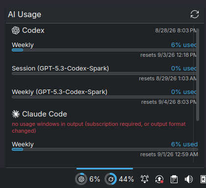

<div align="center">

# AI Usage

Claude Code, Codex, and Grok subscription usage in your KDE Plasma panel or macOS menu bar.

[](https://github.com/NicL9923/ai-usage-widget/actions/workflows/ci.yml)
[](LICENSE)
[](https://kde.org/plasma-desktop/)



</div>

Each provider gets a usage ring in the panel. Open the widget to see every rate-limit
window, its reset time, and any Codex resets you have banked. Rings turn orange at 70% and
red at 85%. A warning badge names any window at 85% or higher, including weekly and
model-specific limits, while the ring continues to show the primary window. Claude Code
doesn't report Claude's banked resets, so the Claude entry links to claude.ai's usage page
instead.

The widget uses the provider CLIs you already have signed in. It does not read or store
OAuth tokens, make model calls, or add anything to your bill.

| Provider | Usage source |
| --- | --- |
| Codex | `codex app-server` |
| Claude Code | `claude --print /usage` |
| Grok | `grok agent` |

## Requirements

- KDE Plasma 6, or macOS 14 Sonoma or newer
- On macOS, Xcode Command Line Tools to build the app: `xcode-select --install`
- Python 3.11 or newer
- At least one supported CLI, signed in to a subscription plan:
  [Codex](https://github.com/openai/codex),
  [Claude Code](https://claude.com/claude-code), or
  [Grok](https://docs.x.ai/build/cli)

API-key and usage-based accounts do not expose subscription windows and will appear
unavailable.

## Install on macOS

Install Python 3.11 or newer and sign in to at least one supported CLI first.
Run the installer from the terminal where those CLIs work:

```bash
git clone https://github.com/NicL9923/ai-usage-widget.git
cd ai-usage-widget
./scripts/install.sh
```

The installer builds a native app for your Mac, installs it to `~/Applications/AI Usage.app`,
and opens it. There is no Dock icon. The menu bar shows each provider's logo inside a ring
that fills with its primary usage, followed by the percentage. Rings turn orange from 70%
and red from 85%. A red dot means another window is at 85% or higher, a faded ring means a
stale reading, and `–` means unavailable. Click it for every window, reset time, banked
Codex reset, and error. Expired windows disappear even when a refresh fails.

Use the gear menu to hide providers and keep the menu bar compact on a MacBook Pro.
The refresh button bypasses the five-minute helper cache. **Launch at login** in the same
menu is optional and uses macOS login items. The app checks once per minute and after wake.

The app contains its own copy of the helper. It retains the Python executable and
terminal PATH from installation so Finder and login launches can find your CLIs.
The installer uses the base Python installation, so deleting a build venv does not
break the app. Python and the CLI installations must stay available. It also saves
`CODEX_HOME`, `CLAUDE_CONFIG_DIR`, and XDG configuration paths when set. It never saves
API keys or the rest of your shell environment. If you move Python, change CLI
locations, or update the code, rerun the installer. It quits the copy being replaced,
checks the bundled helper, and reopens the app. Build it
on each Mac; the locally signed app is not a standalone distribution with bundled Python.

For a build without installing or launching:

```bash
python3 scripts/build-macos.py
open "build/AI Usage.app"
```

The native UI uses Apple's [MenuBarExtra](https://developer.apple.com/documentation/swiftui/menubarextra)
and [SMAppService](https://developer.apple.com/documentation/servicemanagement/smappservice).

## Install on KDE Plasma

```bash
git clone https://github.com/NicL9923/ai-usage-widget.git
cd ai-usage-widget
./scripts/install.sh
```

Then right-click the panel, choose **Add widgets**, and add **AI Usage**. If it is missing
from the list, restart Plasma:

```bash
systemctl --user restart plasma-plasmashell.service
```

Update an existing installation with:

```bash
git pull
./scripts/install.sh --restart-plasma
```

## Configure

Right-click the widget and choose **Configure AI Usage** to select providers, change the
refresh interval, or show provider names. Middle-click the widget to refresh immediately.

The helper caches readings under `$XDG_CACHE_HOME/ai-usage-widget/`. One provider failing
does not block the others, and a failed refresh keeps the last good value visible and marked stale, with its age and the
refresh error. Enabled providers without readings keep their place in the panel and show
an unavailable marker.

The popup shows relative reset times, with exact local timestamps on hover. Once a
window's reset time passes, the next poll probes again. If that refresh fails, the old
percentage is dropped rather than shown for a period that has already ended.
Refreshes show a busy indicator and repeated requests share the active refresh. You can
also focus the panel widget with the keyboard and open it with Enter or Space.

## Use the helper by itself

The installer also adds `ai-usage` to `~/.local/bin`:

```bash
ai-usage                    # JSON for scripts and status bars
ai-usage --plain            # human-readable output
ai-usage --refresh          # bypass the cache
ai-usage --provider codex   # query one provider
ai-usage --ttl 600          # accept cache entries up to 10 minutes old
```

The helper has no runtime dependencies outside the Python standard library. Run it from a
clone without installing it with `PYTHONPATH=src python3 -m ai_usage`.

## Troubleshooting

Run a provider probe directly to see its error:

```bash
ai-usage --provider claude --refresh --plain
```

- **Warning icon.** Hover it for the helper error. Check that `~/.local/bin/ai-usage`
  exists and that the configured helper path is correct.
- **Unavailable provider.** Confirm that its CLI can show subscription usage and is signed
  in. If the widget says you are signed out of Grok, run `grok login`. Grok can also omit
  its percentage until the current period has some usage.
- **Frozen numbers.** Middle-click the widget or use `ai-usage --refresh`.
- **Blank widget after an update.** Check QML errors with
  `journalctl --user --since "-5 min" | grep -i qml`.

## Uninstall

On macOS, turn off **Launch at login**, quit AI Usage, and delete
`~/Applications/AI Usage.app` and `~/.local/bin/ai-usage`.

On KDE Plasma:

```bash
kpackagetool6 -t Plasma/Applet -r com.nicl9923.aiusage
rm -f ~/.local/bin/ai-usage
rm -rf "${XDG_DATA_HOME:-$HOME/.local/share}/ai-usage-widget"
rm -rf "${XDG_CACHE_HOME:-$HOME/.cache}/ai-usage-widget"
```

## Development

```bash
python3 -m venv .venv
.venv/bin/pip install -e '.[dev]'
.venv/bin/ruff check .
.venv/bin/ruff format --check .
.venv/bin/pytest
node --test tests/test_ui.cjs
```

The widget state tests use Node.js's built-in test runner.

On macOS, build the app and run its contract and helper integration tests:

```bash
python3 scripts/build-macos.py
./scripts/test-macos.sh
# Optional light/dark panel renders in a logged-in GUI session:
./scripts/test-macos.sh --render
```

On Nicolas's Mac mini, native builds and tests use the shared heavy-work lock.
Build output and Swift module caches stay under the checkout's ignored `build/`.

Issues and pull requests are welcome. Provider output is not a stable API, so parser fixes
are especially useful.

Provider marks come from [Simple Icons](https://simpleicons.org/) and
[SVG Logos](https://github.com/gilbarbara/logos), both CC0-1.0. Provider names and marks
belong to their respective owners. This project is not affiliated with them.

Released under the [MIT license](LICENSE).
